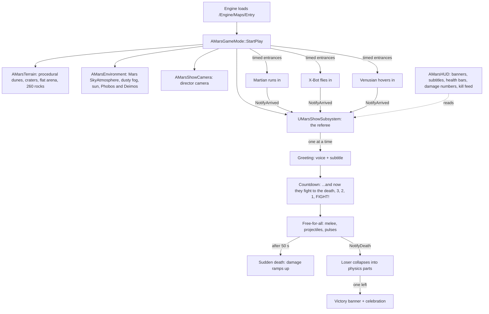

# Mars Hello World (Unreal Engine 5.8)

A "hello world" for Unreal Engine 5 with a bit more drama than usual.

On a red Mars plain under a butterscotch sky, three visitors arrive:

| Who | How they arrive | Voice | How they fight |
|---|---|---|---|
| **The Martian** (green, three eyes, antennae) | Sprints in across the dunes | Deep, slow, warbly | Claw slam, lobbed acid spit, acid volley |
| **X-Bot** (chrome robot, cyan visor) | Flies in on a jetpack and lands hard | Ring-modulated, bit-crushed robot | Eye lasers, laser burst, rocket punch |
| **The Venusian** (gold jellyfish, magenta core) | Hovers in and keeps floating | High, shimmering, echoing | Homing plasma orbs, sonic pulse, tentacle lash |

Each one turns to the camera and says **"Hello, world!"** in its own voice, with subtitles. Then a
countdown starts, *"...and now they fight to the death"*, and it's a free-for-all until one is left.
Losers fall apart (their body parts become physics objects), and the winner gets a victory banner
and a lap of honour. A full show runs about **60 to 90 seconds**. Gravity is Mars gravity (3.71 m/s²),
so everything hops and floats a bit.

The project is **C++-first, with no hand-made binary assets**. The terrain, sky, characters, effects
and HUD are all built by code when the game starts. Three WAV voice files are the only media.

## Run it on Windows

1. Install **Unreal Engine 5.8** from the Epic Games Launcher (Library → Engine Versions → +). Also install
   **Visual Studio 2022** (or newer) with the *Game development with C++* workload and a Windows SDK.
2. Install **Git** and **Git LFS**, then clone:

   ```bat
   git lfs install
   git clone https://github.com/Phil801/mars-hello-world-ue5.git C:\Dev\mars-hello-world-ue5
   ```

3. Right-click `C:\Dev\mars-hello-world-ue5\MarsHelloWorld.uproject` and choose **Generate Visual Studio project files**.
4. Double-click `MarsHelloWorld.uproject`. When it asks to rebuild the missing `MarsHelloWorld` module, click **Yes**.
   The first compile and shader build can take a while.
5. On first editor launch, `Content/Python/init_unreal.py` runs `mars_setup.py` automatically. It imports the voices to
   `/Game/Audio` and creates the materials in `/Game/Materials`. You can also run it yourself from **Tools → Execute Python Script...**:

   ```text
   C:\Dev\mars-hello-world-ue5\Content\Python\mars_setup.py
   ```

6. Press **Play** (Alt+P). Controls: **R** restart, **Space** slow motion, **C** change camera, **H** hide help, **Esc** quit.
7. To package a standalone `.exe`:

   ```bat
   C:\Dev\mars-hello-world-ue5\Scripts\BuildWin.bat "C:\Program Files\Epic Games\UE_5.8"
   ```

   The game ends up in `C:\Dev\mars-hello-world-ue5\Build\Windows\Windows\MarsHelloWorld.exe`.

If you skip step 5 the game still runs. The ground is tinted a single rust colour instead of vertex-painted,
and the voices play straight from `RawAudio/` via a procedural sound wave.

Linux: `Scripts/build_linux.sh /path/to/UnrealEngine`. Container build (needs Epic-linked GitHub access): see
[`Scripts/docker/README.md`](Scripts/docker/README.md).

## How it works



Code map (`Source/MarsHelloWorld/`):

- `Core/`: `MarsGameMode` builds the world and spawns the cast. `MarsShowSubsystem` is the referee and runs the phases
  Arrivals → Greetings → Countdown → Fight → Victory. `MarsShowSettings` holds the tunables (Project Settings → Game → Mars Show).
  `MarsGameplayTags` has the state, damage and species tags. `MarsPlayerController` is spectator input built at runtime with Enhanced Input.
- `World/`: `MarsTerrain` is a procedural mesh with fractal noise, ridges, seeded craters and a flattened arena, plus instanced rocks.
  `MarsEnvironment` holds the sky, fog, light and moons. `MarsAssets` builds bodies from `/Engine/BasicShapes` and handles material fallbacks.
- `Combat/`: `CombatantCharacter` is the shared state machine (Entering → Greeting → Ready → Fighting → Dead/Victorious), AI and attacks.
  `CombatantMartian`, `CombatantXBot` and `CombatantVenusian` hold each character's body, animation and moves (data in `FCombatantProfile`).
  `MarsProjectile`, `MarsHitFlash` (hit effects with no Niagara needed) and `MarsHealthComponent` support them.
- `Audio/MarsVoiceLibrary`: uses the imported SoundWave if there is one. Otherwise it parses `RawAudio/*.wav` into a `USoundWaveProcedural`.
  Otherwise there are subtitles only.
- `UI/MarsHUD`: a Canvas HUD, so no UMG assets are needed. `Camera/MarsShowCamera`: director, wide-orbit and low-action camera modes, plus trauma shake.

Changing the show: edit `Config/DefaultGame.ini` (`[/Script/MarsHelloWorld.MarsShowSettings]`). Change `RandomSeed` for a different
landscape and different fight choices. Set `AutoRestartSeconds=8` to loop the show forever.

## How this was built

The whole project was written by **Grok Bot**, an AI agent working for Phil Burns. It started from no game-dev
knowledge, as a test of learning a field from zero and shipping a real product:

1. Researched Unreal Engine 5 and studied the source of 20 open-source UE5 games, such as
   [tomlooman/ActionRoguelike](https://github.com/tomlooman/ActionRoguelike). Those patterns carried over:
   native gameplay tags, a world subsystem as the game director, `UDeveloperSettings`, data-driven profiles, and target and Build.cs layout.
2. Designed a project that runs **with no binary assets in git**. The world, characters and HUD are generated at runtime,
   and a Python editor script makes the few `.uasset`s that need an editor.
3. Generated the three voices offline (see below). Wrote the C++ against the public UE API docs.
4. It was written on a Linux box **without an Unreal Engine install**, so it has not been compiled yet. Everything that
   must be checked on the first compile and run is listed in [`CHECKS.md`](CHECKS.md).

## Voices

`RawAudio/` holds three 44.1 kHz, 16-bit mono WAVs, loudness-normalised to −16 LUFS. They were made by
`Tools/voice/generate_voices.py` (re-runnable):

| File | Base voice | Effects | Length |
|---|---|---|---|
| `VO_Martian_HelloWorld.wav` | Piper `en_US-libritts_r-medium`, speaker 700, slowed | pitched down about 4 semitones, vibrato, cavern echo | 2.06 s |
| `VO_XBot_HelloWorld.wav` | same model, speaker 333 | 55 Hz ring modulation, 6-bit crush, sample-and-hold, metallic comb | 2.04 s |
| `VO_Venusian_HelloWorld.wav` | same model, speaker 850 | pitched up about 5 semitones, chorus, long airy echoes | 1.36 s |

## Credits and licenses

- **Code**: MIT, © 2026 Phil Burns (see `LICENSE`). **Unreal Engine** is © Epic Games, under the Unreal Engine EULA.
  Engine content used at runtime (`/Engine/BasicShapes`, `/Engine/Maps/Entry`) is covered by that EULA.
- **Piper TTS** (tool used to generate the voices, not shipped): https://github.com/rhasspy/piper. piper-tts 1.8.0 is GPL-3.0.
  Only its *output audio* is in this repo.
- **Voice model** `en_US-libritts_r-medium` (https://huggingface.co/rhasspy/piper-voices). Trained on
  **LibriTTS-R** (https://www.openslr.org/141/, **CC BY 4.0**, from LibriVox public-domain recordings; attribution: Koizumi et al., 2023).
  Its model card says it was *fine-tuned from the Piper "lessac" voice*. The lessac base uses the Blizzard 2013
  Lessac data, which has its own terms. **Check those terms before any commercial release**, or regenerate the voices
  with a voice whose whole lineage is permissive.
- Design patterns are inspired by Tom Looman's ActionRoguelike (MIT). No code was copied.
- No Mixamo, Adobe, Quixel or Marketplace assets are used.
